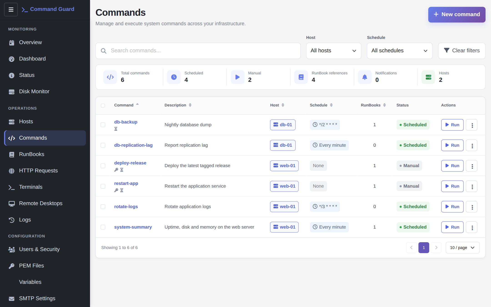
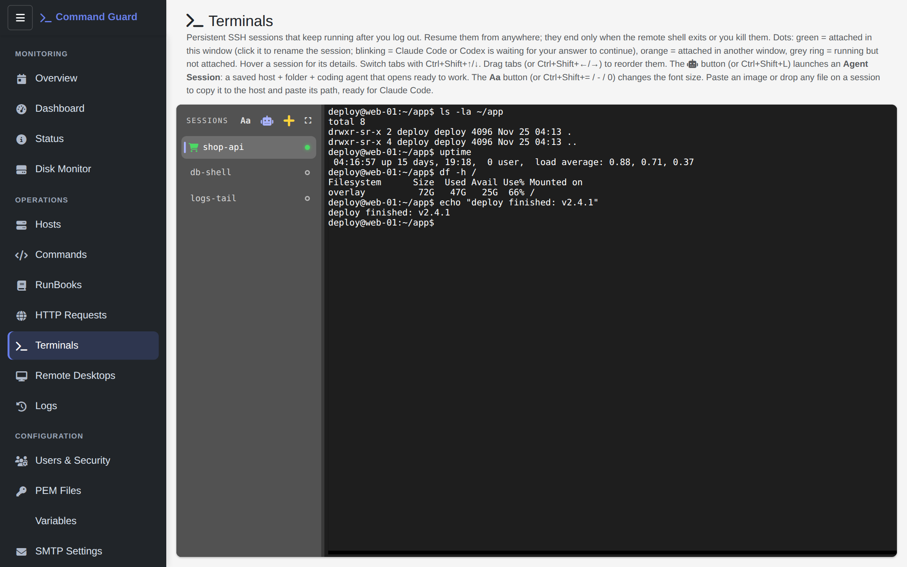
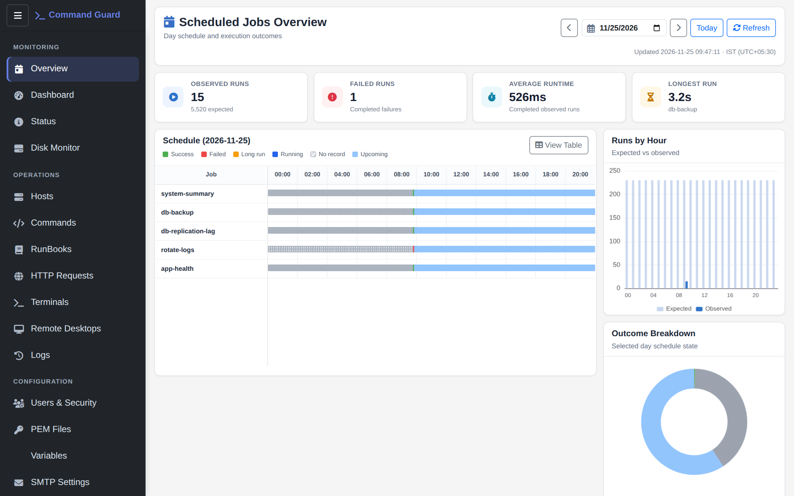
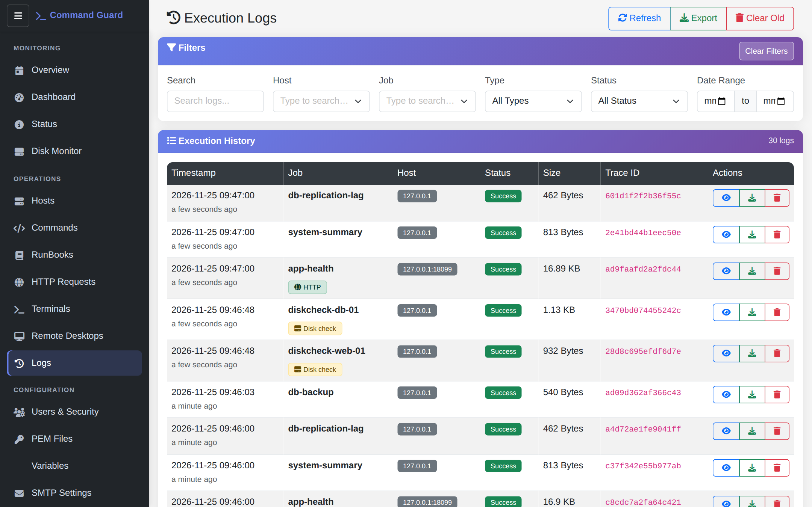
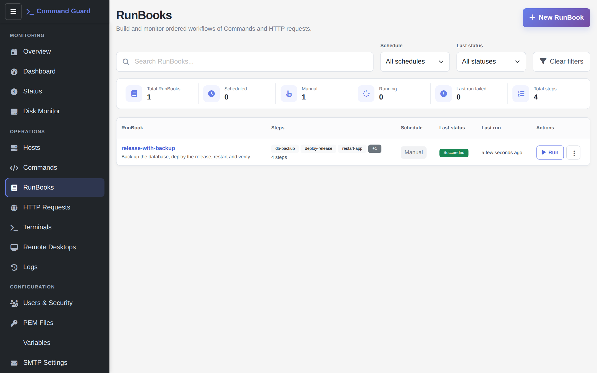
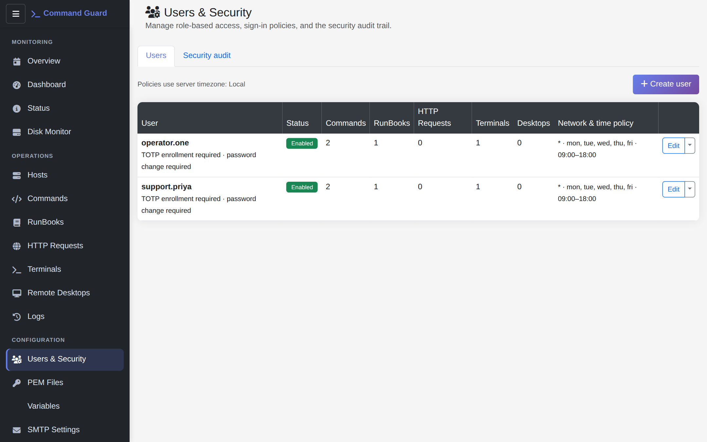
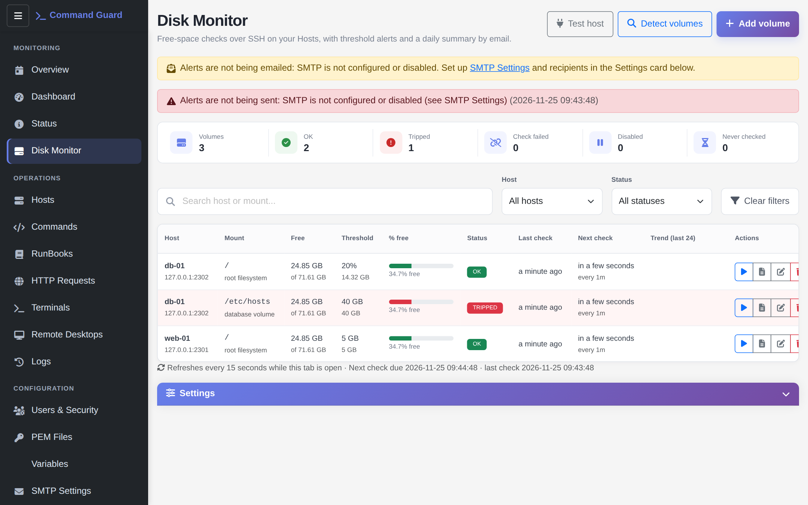

# CommandGuard

**A self-hosted operations console for your servers, in one Go binary.**
Let people run approved commands without handing out SSH access, schedule and chain jobs, and keep browser terminals alive after you close the tab.



CommandGuard sits between your team and your servers. You register hosts (SSH or WinRM) once, save the commands people are allowed to run, and grant each user only what they need. Everything that runs is logged, one file per execution.

It has no database and no agent to install on the hosts: one binary, one `config.json`, and a `logs/` folder.

## What it does

| | |
|---|---|
| **Command delegation** | Save commands against a host and run them from the UI, an HTTP endpoint with a bearer token, or cron. Users see only the commands granted to them. |
| **RunBooks** | Ordered steps with retries, delays, timeouts and stop/continue-on-failure, with live progress and one consolidated result. |
| **Persistent terminals** | SSH terminals in the browser (xterm.js) that keep running after you log out and after the server restarts. Paste an image or drop a file onto a session to copy it to the host. |
| **Agent Sessions** | Saved presets (host + folder + coding agent) that open a terminal ready to work. The tab blinks when the agent is waiting for your answer. |
| **HTTP requests** | Saved API calls with auth, retries, expected status and assertions; run manually, on cron or as RunBook steps. |
| **Disk Monitor** | Free-space checks over SSH with thresholds, alert emails with cooldown, and a daily summary. |
| **Remote desktops** | VNC in the browser (noVNC), direct or through an SSH tunnel. Passwords never reach the browser. |
| **Users and security** | TOTP two-factor sign-in, per-user grants, IP allow-lists, weekday and time-of-day windows, login lockout, and a security audit log. |
| **Notifications** | Email (SMTP, queued) and webhooks per command and per RunBook. |
| **Operations** | Bastion (jump) hosts, hot config reload, encrypted backup and restore, optional S3 log storage, `--validate` for CI. |

<details>
<summary>More screenshots</summary>








</details>

## Quick start

You need Go 1.26 or newer.

```bash
git clone https://github.com/pari/command_guard.git
cd command_guard

./compile_and_run.sh
```

The script builds everything into `instance/`, creates `instance/config.json` from `config.json.sample` on the first run, and starts the server from there. To do the same by hand:

```bash
mkdir -p instance
go build -o instance/cguard .
go build -o instance/cg_sessiond ./sessiond   # only needed for browser terminals
cp -r ui email.tpl instance/
cp config.json.sample instance/config.json
cd instance
./cguard --validate
./cguard
```

`instance/` is your installation: it holds `config.json`, your SSH keys (`pem_files/`) and the logs. It is git-ignored; back it up and never delete it as if it were build output.

Open <http://127.0.0.1:8080>. On first start there is no admin account yet: the sign-in page asks you to choose an admin password (12 characters or more) and then shows a QR code to enrol your authenticator app.

The sample config contains two placeholder hosts. Replace them on the **Hosts** page, add a command on the **Commands** page and press **Run**.

### Docker

```bash
docker build -t commandguard .

docker run -d --name commandguard \
  -p 127.0.0.1:8080:8080 \
  -v commandguard-data:/app/data \
  commandguard
```

Everything that must survive a restart (`config.json`, keys, logs) lives in the `/app/data` volume. On first start the container creates `config.json` there from the sample. Browser terminal sessions end when the container stops, because the session daemon runs inside it.

## Calling a command from a script

Give a command a `bearer_token` and it becomes an HTTP endpoint:

```bash
curl -H "Authorization: Bearer <command-token>" \
  http://127.0.0.1:8080/api/commands/system-summary
```

The response is JSON with the output, exit code, duration and a `trace_id`; the full log is at `/api/logs/<trace_id>`.

## Documentation

| Document | Contents |
|---|---|
| [docs/user-manual.md](docs/user-manual.md) | Full guide: setup, UI, API, scheduling, notifications, variables |
| [docs/multi-user.md](docs/multi-user.md) | Users, grants, sign-in policies, trusted proxies |
| [docs/runbooks.md](docs/runbooks.md) | RunBook schema and execution rules |
| [docs/terminals.md](docs/terminals.md) | Persistent terminals and Agent Sessions |
| [docs/http-requests.md](docs/http-requests.md) | Saved HTTP requests |
| [docs/disk-monitor.md](docs/disk-monitor.md) | Disk Monitor fields, alerts and API |
| [docs/vnc.md](docs/vnc.md) | Remote desktops |
| [docs/test-setup.md](docs/test-setup.md) | Running the test suite against real SSH/WinRM servers |

## Security

CommandGuard holds credentials for your servers, so treat the machine it runs on accordingly.

- Run it behind a TLS-terminating reverse proxy and set `trusted_proxies`; do not expose it directly to the internet.
- `config.json` and `pem_files/` contain secrets. Keep them out of version control (the shipped `.gitignore` does) and readable only by the service account.
- Never set `dev_mode: true` outside development: it enables a fixed password and TOTP code.
- Known limitations are listed in [SECURITY.md](SECURITY.md). Please read them before a production deployment, and report vulnerabilities privately as described there.

## Project status

Version 0.7.0. The author has run it in production daily since 2025, but the public project is young: expect rough edges and breaking config changes before 1.0.

## Contributing

Issues and pull requests are welcome. See [CONTRIBUTING.md](CONTRIBUTING.md).

## Licence

[MIT](LICENSE). Bundled third-party components keep their own licences; see [THIRD_PARTY_NOTICES.md](THIRD_PARTY_NOTICES.md).
